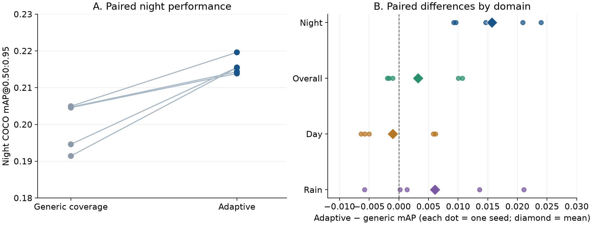

# Target-aware subset selection for nighttime object detection on BDD100K

## Abstract

We tested whether selecting a fixed-size training subset with extra coverage of weak nighttime object classes improves a detector under a fixed training budget. From 70,000 BDD100K training images, each method selected 7,500 images. Faster R-CNN detectors were trained for 7,500 optimizer updates at five paired seeds. On 3,126 held-out nighttime images, the adaptive subset improved COCO mAP@0.50:0.95 by **0.0157 absolute** on average relative to generic metadata coverage; all five paired seeds improved. The exploratory 95% paired *t* interval was [+0.0075, +0.0239]. On all 8,500 held-out images, the mean difference was +0.0032, with an interval spanning zero. A post-final control matching the adaptive subset's night-image count recovered +0.0094 of that +0.0157 gain; the remaining +0.0063 adaptive advantage was uncertain. An exploratory second-target rain experiment produced only +0.0034 rainy mAP over generic coverage on average, with a wide interval crossing zero. The study does not establish improvement across other datasets, architectures, or budgets.

## Question and setting

BDD100K contains varied driving conditions, including different times of day and weather [1]. Our question was: **with 7,500 labeled training images and 7,500 optimizer updates, can a subset chosen for nighttime weaknesses outperform generic metadata coverage on nighttime detection while retaining general performance?** This is data selection for a fixed detector, rather than an architectural domain adaptation method such as [2].

The training pool contains 70,000 images and approximately 1.288 million valid detection boxes in ten classes. We partitioned the original 10,000-image validation set into a 400-image night query set, a 100-image rain query set, a 1,000-image development set, and an 8,500-image final set. The groups are disjoint. The final set contains 3,126 night, 4,650 daytime, and 532 rainy images; weather and time-of-day slices can overlap. The query images supplied pixels for exploratory visual selection variants. **The final adaptive method did not use query pixels or query labels.** Development labels and metrics informed its class weights and checkpoint choice. Final-set labels were reserved for scoring after the protocol was frozen.

## Selection methods

The generic coverage baseline represents each training image with tokens for weather, scene, time of day, their pairwise combinations, presence of each detection class, and presence of small, medium, and large boxes. It selects 7,500 images by lazy greedy maximization of a weighted sum of square-root token counts:

\[
F(S)=\sum_t w_t\sqrt{n_t(S)}, \qquad w_t=f_t^{-1/4},
\]

where \(n_t(S)\) counts selected images containing token \(t\), and \(f_t\) is that token's frequency in the training pool. Diminishing returns encourage coverage of less represented attributes. The objective is monotone submodular, and greedy selection has the standard cardinality-constraint approximation guarantee for **this selection objective** [3]. That guarantee says nothing about detector mAP.

The adaptive method adds a `target_class=<class>` token to each night image containing that class. Its token weight is the same frequency-adjusted weight multiplied by \(1+12\max(0,g_c)\), where \(g_c\) is the average daytime-minus-nighttime per-class AP gap measured from three generic-coverage development runs (seeds 42–44). Classes without a positive gap receive no extra multiplier. This uses labeled development feedback to prioritize known night weaknesses. Both methods apply the same square-root coverage objective and greedy code; seed controls tie breaking and training randomness. In the seed-42 manifests, generic coverage selected 1,732 night images and adaptive coverage selected 3,851. The method therefore changes the training distribution as well as class-time coverage.

Exploratory development variants also included random selection, night-only sampling, a manual 80% night mix, metadata target weighting, and two ResNet-50 query-feature schemes. The visual variants did not reproduce an advantage over generic coverage across their three full-budget development seeds. Those explorations are documented in `DEVELOPMENT_RESULTS.md`, `DEVELOPMENT_VISUAL_RESULTS.md`, and `PILOT_RESULTS.md`; they were not added to the frozen primary final comparison.

## Training and evaluation protocol

All paired runs used COCO-pretrained TorchVision Faster R-CNN with a ResNet-50/FPN backbone and a new ten-class detection head [4]. The training setup used SGD (initial learning rate 0.005, momentum 0.9, weight decay 0.0005), batch size 2, horizontal-flip augmentation, image resizing to minimum/maximum 640/1024 pixels, BF16 autocast, and 7,500 optimizer updates. The learning rate decayed at updates 3,000 and 6,000. Development loss was checked at updates 3,750 and 7,500; the lower-loss checkpoint was scored on the final set. Each method used a seed-specific 7,500-image manifest for seeds 42–46; seed changes selection tie breaking and training randomness, but the selected sets can overlap heavily. The final endpoint and these rules were recorded in `FINAL_EVALUATION_PROTOCOL.md` before final-set scoring.

The primary endpoint was the mean paired difference in night COCO mAP@0.50:0.95, adaptive minus generic. Overall mAP was the retention endpoint; daytime and rainy mAP were secondary slices. Both methods used the same final images for every seed. The analysis reports paired differences, rather than choosing a favorable run.

## Results

| Final-set COCO mAP@0.50:0.95 | Generic mean | Adaptive mean | Mean paired difference | Exploratory 95% interval |
|---|---:|---:|---:|---:|
| Night (3,126 images; primary) | 0.2001 | 0.2158 | **+0.0157** | [+0.0075, +0.0239] |
| Overall (8,500; retention) | 0.2198 | 0.2231 | +0.0032 | [-0.0049, +0.0113] |
| Daytime (4,650) | 0.2294 | 0.2283 | -0.0010 | [-0.0090, +0.0070] |
| Rainy (532) | 0.2505 | 0.2566 | +0.0061 | [-0.0075, +0.0197] |

The night paired differences for seeds 42–46 were +0.0147, +0.0096, +0.0093, +0.0209, and +0.0240. The five adaptive models have tighter night results (0.2139–0.2196), while the generic models range from 0.1914 to 0.2050. This pattern is descriptive; the experiment does not isolate whether the gain comes from class-gap weighting, more night images, or their interaction. Overall mAP rose in two of five pairs and fell in three, so the data do not establish a general-performance gain. The rainy result is especially uncertain because the slice contains 532 images and rain was not the target.

*Figure 1.* Each line in panel A connects models trained with the same seed. In panel B, dots are seed-level adaptive-minus-generic differences and diamonds are five-seed means. The PDF version is `figures/final_paired_comparison.pdf`.

The intervals use a two-sided paired *t* calculation over five seed-level differences (four degrees of freedom). They describe run-to-run variation under this fixed image set. They do **not** account for uncertainty from sampling a new evaluation set, a different driving dataset, or selecting a different model family. Given five seeds and the development history, they should be read as exploratory uncertainty, not a strong significance claim.

## Interpretation and limits

The observed night gain is consistent with a simple mechanism: the adaptive objective selects more night images containing classes that generic models found difficult at night. A post-final, five-seed night-count control selected exactly 3,851 night images per subset using generic coverage weights. On the held-out night set it gained +0.0094 mAP over generic coverage, while adaptive gained another +0.0063 over this control. The exploratory paired interval for that increment was [-0.0019, +0.0145], so the evidence does not establish an additional benefit from class-gap weighting beyond the night count. See `NIGHT_COUNT_CONTROL_RESULTS.md` and its separately recorded protocol. Because this ablation was designed after viewing primary final results, it is not an independent confirmatory test.

## Exploratory second target: rain

We repeated the same selection and training budget with rain as the target. The extra `target_class=c` token now applies to rainy training images, and the class weight uses the positive part of the *nonrain-minus-rainy* development AP gap from generic seeds 42–44. We kept the multiplier 12 from the night study rather than tuning it for rain. Each of five rain-adaptive subsets and its rain-count control contains 7,500 images, including exactly 2,851 rainy images. The rain-count control maximizes generic metadata coverage subject to that rainy-image count. Generic coverage uses the previously trained target-agnostic models; its seed-42 subset contains 1,455 rainy images. The experiment plan was recorded in `RAIN_EXPERIMENT_PROTOCOL.md` before selecting rain subsets or training rain-targeted models.

| Final-set rainy mAP@0.50:0.95 (532 images) | Five-seed mean | Difference from generic | Exploratory 95% paired interval |
|---|---:|---:|---:|
| Generic coverage | 0.2505 | — | — |
| Rain-count control | 0.2552 | +0.0047 | [-0.0133, +0.0226] |
| Rain-adaptive | 0.2539 | +0.0034 | [-0.0173, +0.0241] |

Rain-adaptive minus rain-count control was **-0.0012** on average, with an exploratory paired interval of [-0.0171, +0.0146]. Four of five pairs favored the adaptive method, but seed 42 had a larger loss (-0.0229) than those gains. The overall mAP difference from generic was -0.0009 for rain-adaptive and -0.0005 for the count control, both with intervals crossing zero. Thus this experiment does not show a reliable rain benefit or an added effect of class-gap weighting beyond rainy-image count. Full per-seed and domain results are in `RAIN_EXPERIMENT_RESULTS.md`.

A post-final class audit found that seed 42's adaptive model had lower rainy AP than its count control for all nine evaluable classes. Rider had the largest class drop (-0.0635 AP); that class has only 27 ground-truth boxes in the rainy final slice. Across five seeds, rider remained the largest negative class difference (-0.0279 AP, five of five pairs lower), even though its development AP gap was zero and its rainy training-box count was unchanged. The paired subsets share 6,838 of 7,500 images in every seed, and the adaptive subset contains more rainy training boxes for most classes, so raw class-box counts do not explain the seed-42 loss. Seed 42 also selected an earlier adaptive checkpoint (update 3,750 versus 7,500 for the control) and a different rainy day/night mix. The saved aggregate metrics cannot separate these factors. The class table, subset counts, and reproduction script are in `RAIN_CLASS_ERROR_ANALYSIS.md` and `analyze_rain_classes.py`.

A separate inference-only diagnostic scored the seed-42 adaptive checkpoint at update 7,500 on the same 532 rainy final images. Its rainy mAP rose from 0.2368 at the protocol-selected update 3,750 to 0.2560 at update 7,500, closing 84% of the original gap to the count control (0.2597). At update 7,500, adaptive mAP was 0.2773 versus 0.2752 for the control on rainy daytime images, but 0.2641 versus 0.2847 on rainy nighttime images. The earlier adaptive checkpoint had lower whole-development loss, so the frozen protocol still selects it. These post-final comparisons help locate the seed-42 gap; they do not justify replacing its primary result or prove that the smaller number of rainy nighttime training images caused the remaining difference. See `RAIN_SEED42_CHECKPOINT_DIAGNOSTIC.md`.

The rainy baseline scores on this final partition had already been inspected during the night study, so this is an exploratory reuse of a viewed set. The rainy development slice has only 78 images, making its class AP gaps noisy; the rainy final slice has 532 images. The paired intervals describe training-seed variation on this fixed set, not variation across new rainy scenes. The rain-count control also imposes a quota, so the cardinality-only greedy approximation guarantee stated for the unconstrained selector should not be applied to that control.

Both target experiments use one detector, one subset size, and one update budget. Development feedback came from three generic runs, while the adaptive and generic five-seed comparison reused those seeds for training; no final labels entered that feedback. Results from older full-70k or epoch-based runs are not directly comparable because their budgets and validation set differ.

The next test for broader claims should use a fresh evaluation set, then vary the compute or subset budget. A second architecture or external driving dataset would test transfer.

## Reproducibility

- Frozen split manifests: `research_splits/`; selected-image manifests and SHA-256 records: `research_subsets/`.
- Selection code: `select_subsets.py`; training: `train.py`; domain scoring: `evaluate_domains.py`.
- Per-run configs, histories, checkpoints, and final metric CSVs: `outputs/experiments/benchmark_night_*_seed*_steps7500/`.
- Analysis and figure generation: `summarize_final_evaluation.py`, `plot_final_evaluation.py`.
- Exact five-seed numbers: `FINAL_EVALUATION_RESULTS.md`; frozen endpoint: `FINAL_EVALUATION_PROTOCOL.md`.
- Exploratory rain protocol, manifests, and results: `RAIN_EXPERIMENT_PROTOCOL.md`, `research_subsets/rain_seed*/`, and `RAIN_EXPERIMENT_RESULTS.md`.
- Rain class and subset audit: `RAIN_CLASS_ERROR_ANALYSIS.md`, generated by `analyze_rain_classes.py`.
- Seed-42 rain/time and checkpoint diagnostic: `RAIN_SEED42_CHECKPOINT_DIAGNOSTIC.md`, generated from `evaluate_rain_time_diagnostic.py` and `summarize_rain_time_diagnostic.py`.

## References

1. Yu et al., [BDD100K: A Diverse Driving Dataset for Heterogeneous Multitask Learning](https://openaccess.thecvf.com/content_CVPR_2020/html/Yu_BDD100K_A_Diverse_Driving_Dataset_for_Heterogeneous_Multitask_Learning_CVPR_2020_paper.html), CVPR 2020.
2. Chen et al., [Domain Adaptive Faster R-CNN for Object Detection in the Wild](https://openaccess.thecvf.com/content_cvpr_2018/html/Chen_Domain_Adaptive_Faster_CVPR_2018_paper.html), CVPR 2018.
3. Nemhauser, Wolsey, and Fisher, [An Analysis of Approximations for Maximizing Submodular Set Functions—I](https://thibaut.horel.org/submodularity/papers/nemhauser1978.pdf), *Mathematical Programming*, 1978.
4. Ren et al., [Faster R-CNN: Towards Real-Time Object Detection with Region Proposal Networks](https://arxiv.org/abs/1506.01497), NeurIPS 2015.
